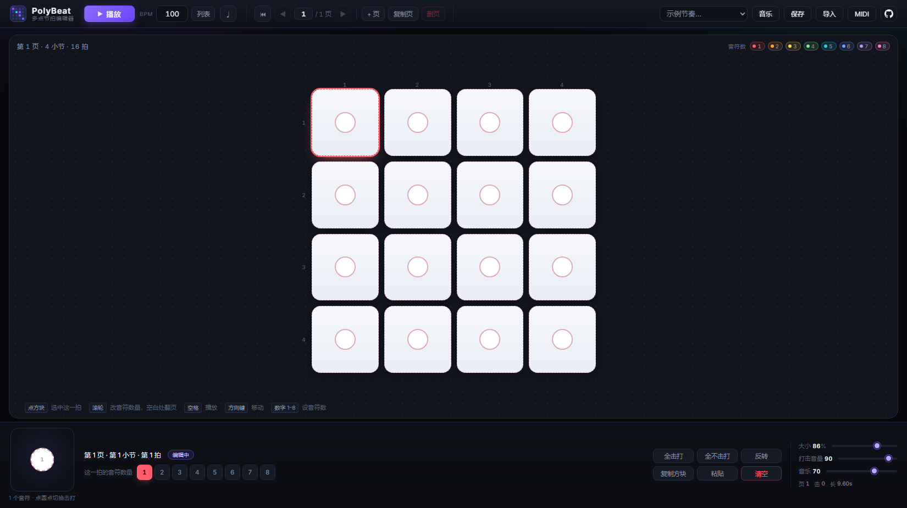
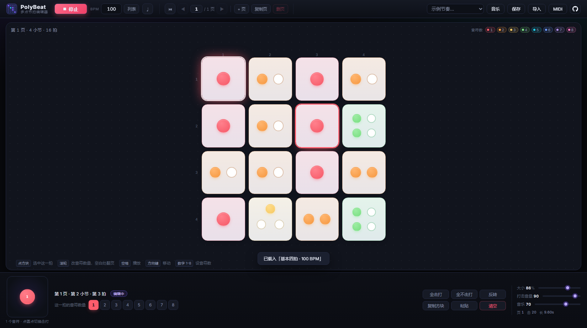
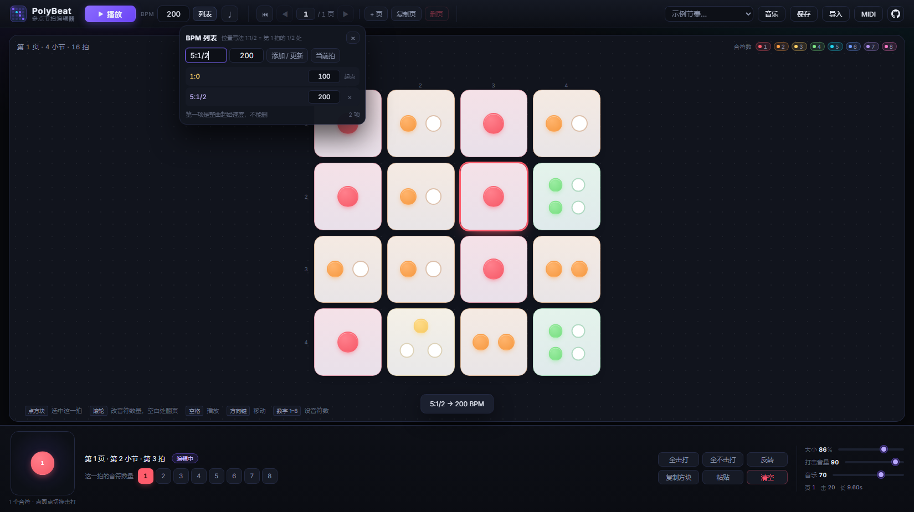
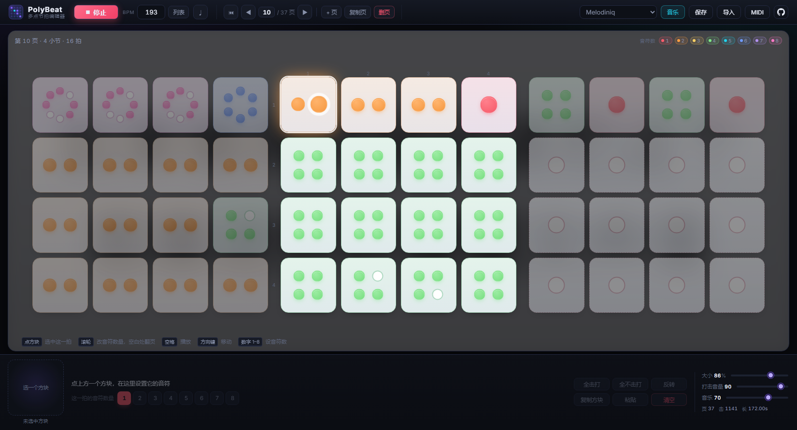
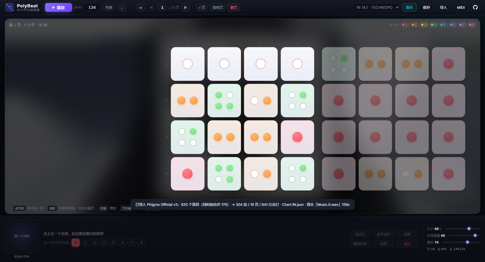
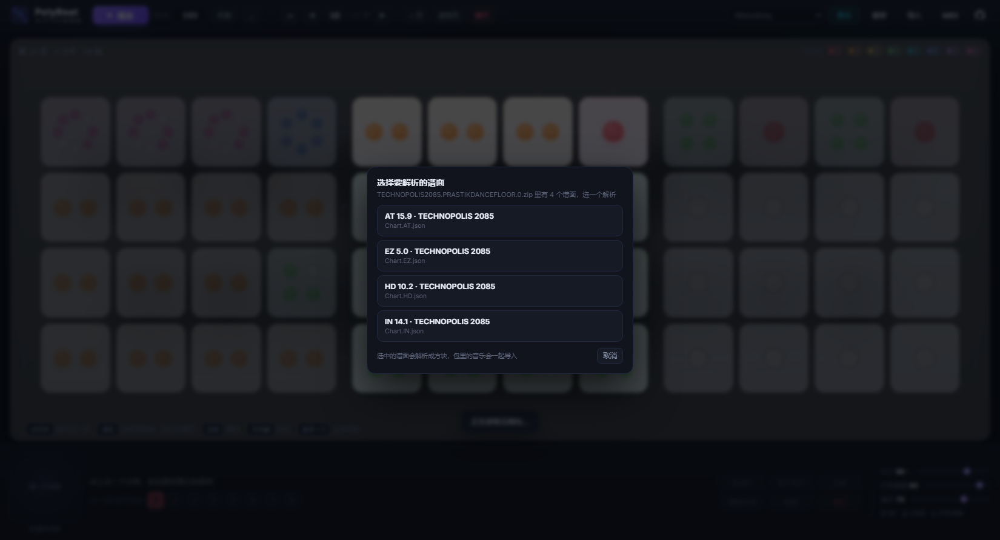
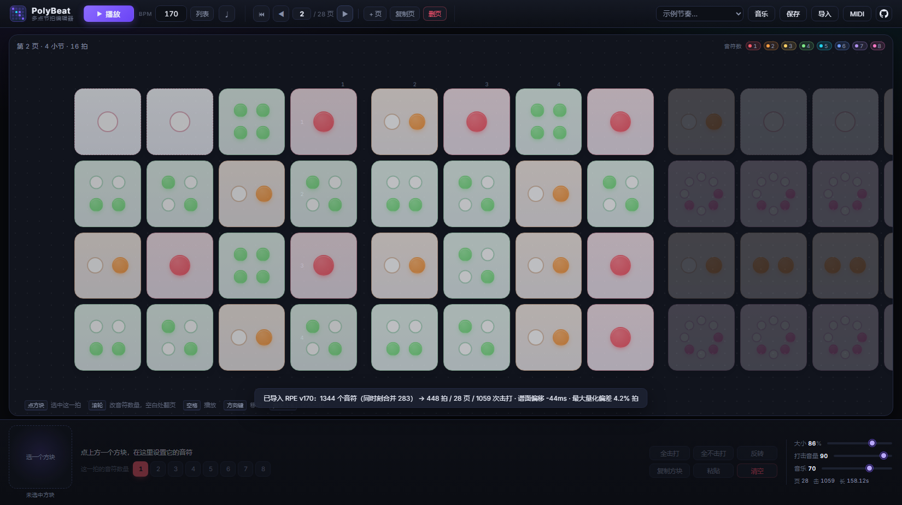
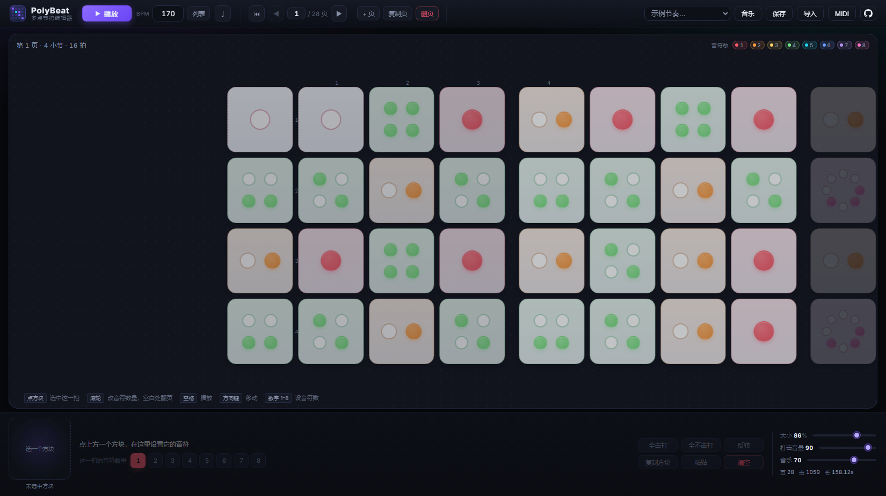

# PolyBeat · 多点节拍

网页版方块节拍编辑器。一个不依赖任何库、不依赖网络的单页应用：一块 = 一拍，一拍里放几个音符就分几份，逐个决定击打或不击打，方块的底色代表这一拍里的音符数量，页可以翻着连续播放。

## 打开方式

在线版：**https://jile-o1b.github.io/PolyBeat/**

也可以双击 `index.html` 本地打开（Chrome / Edge / Firefox 均可），不需要安装、不需要服务器、不联网。

如果浏览器以本地文件方式打开且禁用了持久存储，工具栏会出现「自动保存不可用」提示，此时请用 **保存** 导出工程文件。

## 默认状态

打开就是**一页 16 个正方形空方块**，每个方块里 1 个音符点（居中一个空心圆，表示还没击打）——选中方块后，在下方面板里点圆点就是一下。想改音符数量，同样在下方面板改。



选一个「示例节奏」后是这样的（方块颜色 = 这一拍里的音符数量，实心 = 击打，空心 = 不击打）：



## 模型

```
一页 = 4 × 4 = 16 个方块 = 16 拍 = 4 小节（4/4）
一个方块 = 一拍，方块是正方形
一个方块里可以设 N 个音符（N = 1…8），这一拍就平均分成 N 份
每一份单独决定「击打」或「不击打」
```

- **音符点排成几何图形**：1 个 = 中心一个点；2 个 = 左右两点；3 个 = 等边三角形；4 个 = 正方形四角；5–8 个 = 正多边形。点的中心始终对准方块中心。
- **击打顺序 = 看得见的顺序**：从上到下，同一高度从左到右。3 个点就是「顶点 → 左下 → 右下」，4 个点是「左上 → 右上 → 左下 → 右下」。
- **颜色 = 音符数量**：1 红、2 橙、3 黄、4 绿、5 青、6 蓝、7 紫、8 粉，右上角有图例。
- **实心深色 = 击打，空心浅色 = 不击打**。
- 方块里不显示任何文字，只有颜色和点。

## 打击音

所有击打共用同一个音效：项目根目录的 `hit.wav`（44.1kHz 立体声）。

这个文件已经过处理：去掉开头 153ms 静音、峰值归一化到 0.9、加 1ms 淡入和 8ms 淡出——原始文件前面有 153ms 空白，直接播会让每一下都晚 150ms。

浏览器不允许 `file://` 页面读取本地文件，所以**声音另有一份内嵌副本** `js/hit.js`（base64）。双击打开时用内嵌那份；用 http 服务器打开时会优先读 `hit.wav`。

**换音效**：把新的 wav 放到 `PolyBeat/hit.wav`，然后在项目目录执行

```bash
node tools/embed-hit.js
```

它会重新裁剪、归一化、写回 `hit.wav` 并重建 `js/hit.js`。

## 怎么用

| 操作 | 效果 |
|---|---|
| 点一个方块 | 选中这一拍，下方面板出现它的全部设置 |
| 滚轮停在方块上 | 增减这一拍的音符数量 |
| 滚轮停在空白处 | 上一页 / 下一页 |
| 下方「音符数量」1–8 | 直接设定数量，**新的音符默认全部击打**，再点掉不要的 |
| 下方多边形里点圆点 | 切换这个点击打 / 不击打（圆点上的数字就是击打顺序） |
| 「全击打 / 全不击打 / 反转」 | 一键处理这一拍 |
| 「复制方块 / 粘贴」 | 把一整拍（数量 + 击打图样）搬到别处 |
| 右上「+ 页 / 复制页 / 删页」「◀ ▶」 | 编辑和管理页面 |

改音符数量时，新的 N 个音符**默认全部击打**，再逐个点掉不要的——这样先设数量、再减法，比从全空开始填快。

## 变速（BPM 列表）

顶部那个 BPM 显示的是**当前这一拍**的速度：播放时跟着播放头走，停止时跟着你选中的方块走。直接在顶部改数字，就是给当前这一拍设一个速度标记。

点 BPM 旁边的 **列表** 打开变速表：



| 位置写法 | 含义 |
|---|---|
| `1:1/2` | 第 1 拍的 `1/2` 处 |
| `4` | 第 4 拍开头（等于 `4:0`） |
| `9:1/4` | 第 9 拍的 `1/4` 处 |

- 位置是**全曲第几拍**（跨页连续计数），1 基。
- 分子分母都能写，也接受小数（`5:0.75`）。
- **拍内变速是真的按拍内切分**：在第 5 拍的 `1/2` 处设成 200，这一拍前半段仍是旧速度、后半段起用新速度，这一拍的总时长会变成两段之和。
- 加、改、删都**立即生效**，不需要点应用；播放中改动，从下一拍开始听到。
- **列表第一项 `1:0` 就是整曲起始速度**，没有单独的"基准 BPM"：改顶部数字、或者改列表第一项，改的是同一个值。第一项不能删。
- **BPM 支持两位小数**（如 `174.5`），不会四舍五入成 175；谱面里 `192.99999999999997` 这种浮点误差会规整成 `193`。顶部的 BPM 框和列表里的输入框都设了 `step=0.01`。
- 同一位置只有一项，重复添加就是改值。

## 播放

- 支持逐拍变速（见上节），播放时每一拍按自己那段的速度走。
- 节拍器独立开关（工具栏的 ♩）。
- 播放从当前页开始，**自动翻页**，播到最后一页再回到第一页循环。
- **音乐比谱面长的时候不会提前切回第一页**：谱面的最后一拍放完，播放会停在最后一页**走空拍**（标题显示「· 空拍中」、方块变淡、不再高亮，开了节拍器还能听到空拍），一直等到音乐放完才回到第一页重来。谱面比音乐长时则按谱面长度循环，不受影响。
- 播放中翻页会立刻从新页开头接着播。
- 正在响的方块有白色描边高亮，正在响的那一份音符会闪一下。
- 击打时刻是准的，**没有随机抖动**：同一个 `hit.wav` 按谱面时间原样播放。

## 导入（工程 / 谱面 / PEZ / 音乐）

**导入** 一个按钮通吃，按内容自动识别，也可以直接把文件拖进窗口：

| 文件 | 识别方式 | 结果 |
|---|---|---|
| PolyBeat 工程 | JSON 里 `app === "PolyBeat"` | 恢复整个工程（含速度表） |
| RPE 谱面 | JSON 里有 `BPMList` / `META` | 转成方块节拍 + 变速表 |
| Phigros 官方谱面（fv3） | JSON 里有 `formatVersion`，判定线带 `bpm` | 同上 |
| Rizline 谱面 | JSON 里有 `lines` + `bPM`（没有 `judgeLineList`） | 同上 |
| RPE 的 `.pez` / 任意 zip | 开头是 `PK` 或后缀 `.pez` / `.zip` | 解包，把里面的谱面 **和音乐** 一起导入 |
| 音频文件 | mp3 / ogg / wav / m4a / flac | 只当伴奏（等同「音乐」按钮） |



`.pez` 就是一个 zip（谱面 json + 音乐 + 曲绘 + `info.txt`）。导入时先读 `info.txt` 里的 `Chart:` / `Song:` 找对应文件，找不到再按扩展名兜底。没压缩（stored）和 deflate 两种都支持。

### 谱面背景（曲绘）

包里只要有图片（`Illustration*.png`、封面、背景图），就会自动拿来当**谱面背景**：



- 处理：`blur(28px) brightness(.62) saturate(.85)`，再盖一层 `rgba(9,11,16,.56→.64)` 的暗色蒙版，压到不抢方块的视觉效果。
- 选图规则：优先名字带 `illustration` / `cover` / `jacket` / `bg` 的，跳过 `blur` / `thumb` / `icon` 这类（模糊是我们自己做），都没有就取体积最大的一张。
- 换难度不会换背景；导入单文件谱面、工程、或切换示例节奏时清掉。
- 也可以直接把一张图片拖进窗口，单独设成背景。
- 背景不进工程 JSON、也不会自动保存，重新打开页面需要重新导入。

### 一个包里好几个谱面

像 Phigros 官方的 `TECHNOPOLIS2085.*.zip` 那种，一个包里装着 EZ / HD / IN / AT 四个难度，导入时会**弹窗让你选**：



- 每一项显示「难度 等级 · 曲名」和文件名，等级和曲名是从包里的 `Info.json` 读的。
- 选完之后，右上角的 **示例节奏** 下拉会变成两块：

  | 分组 | 内容 |
  |---|---|
  | 包内谱面 | 这个包里的全部谱面，随时切换，切换会重新解析 |
  | 示例节奏 | 内置的几个示例 |

- 换难度不会重新解码音乐，只是重新解析谱面。
- 按 `Esc` 或点「取消」就什么都不导入。
- 导入单文件谱面或工程后，下拉会恢复成只有示例节奏。

### 时间换算

| 格式 | 换算 |
|---|---|
| **RPE** | note 的 `startTime` 是 `[整数拍, 分子, 分母]`，`a + b/c` 就是拍；`BPMList` 原样变成变速表 |
| **Phigros 官方谱**（formatVersion 1/3） | 时间单位是 128 分音符 = `1.875 / bpm` 秒，先换成秒再按基准 BPM 换成拍 |

### 关于 offset

谱面里的 offset 表示「音乐和谱面第 1 拍差多少」，导入时会存下来，播音乐时用：

| 格式 | 字段 | 含义 |
|---|---|---|
| RPE | `META.offset`（毫秒） | 负数：音乐比谱面早开始；正数：晚开始 |
| Phigros 官方 | `offset`（秒） | 正数：谱面比音乐快（音乐相对落后） |

两种情况都换算成同一件事：**第 1 拍那一刻，音乐应该处在第几秒**。所以

- `offset = -44ms`（`RPEformat/example.json`）→ 第 1 拍时音乐已经在 0.044 秒处；
- `offset = +0.5s` → 第 1 拍时音乐还没开始，延后 0.5 秒再进；
- 导入提示里会显示「谱面偏移 -44ms」。

### 转换规则

- **一个方块 = 一拍**，每拍里的音符位置会挑一个能对齐的最小细分数（1–8）：位置在 1/2 就用 2 个音符，1/3 用 3 个，1/4 用 4 个，以此类推。
- **同一时间的多个音符只算一个**：和弦、多判定线同拍落下的都会被压成一次击打。
- RPE 里 `isFake = 1` 的假音符不导入（它们在游戏里本来就不发声）。
- 基准 BPM 取出现次数最多的那条判定线的 bpm；超出 4–2000 的速度会被夹到范围内。
- 超过 64 页（1024 拍）会截断，导入提示里会说明。
- 导入后可以 `Ctrl+Z` 撤回。

**关于精度**：这个模型一拍最多 8 个音符，所以 1/32 拍这类位置对不齐。导入时会选误差最小的细分，并在提示里给出「最大量化偏差」（示例谱面是 4.2% 拍，绝大多数拍是 0）。

四份示例谱面的结果：
| 谱面 | 原始音符 | 同时刻合并 | 结果 |
|---|---|---|---|
| `RPEformat/example.json`（World Vanquisher, 170 BPM, offset -44ms） | 1344 | 283 | 448 拍 / 28 页 / 1059 次击打 |
| `RPEformat/Melodiniq.pez`（RPE v140, 193 BPM 起，16 段变速） | 1349 | 208 | 588 拍 / 37 页 / 1141 次击打 + 音乐 181 秒 |
| `fv3format/example.json`（180 BPM） | 595 | 87 | 408 拍 / 26 页 / 497 次击打 |
| `fv3format/TECHNOPOLIS2085.*.zip` 的 IN 难度 | 820 | 179 | 304 拍 / 19 页 / 641 次击打 + 音乐 139 秒 |
| `rizformat/example.json`（Rizline, 153.51 BPM） | 751 | 87 | 340 拍 / 22 页 / 664 次击打 |

### Rizline 谱面的对应关系

| Rizline | 这里 |
|---|---|
| `bPM` | 基准 BPM（`153.50999450683597` 会被规整成 `153.51`） |
| note 的 `time`（tick，1 tick = 60/bPM 秒） | 直接就是拍号 |
| `bpmShifts[].time` / `.value` | 变速点拍号 / `bPM × value` |
| `lines[].notes[]` | 音符；`type` 0/1/2 都算击打 |
| Hold 的尾巴（`otherInformations[0]`） | 不单独算一次击打，只取头部 |
| `offset`（秒） | 谱面偏移，目前谱面里都是 0 |

## 伴奏（导入音乐）

点右上角 **音乐** 导入音频，或者直接导入带音乐的 `.pez`。

- 播放时音乐和方块跑在**同一个 AudioContext 时钟**上：第 1 拍对齐音乐对应位置，不会出现两套计时器越跑越偏。
- 从中间某一页开始播，音乐会从那一拍对应的位置接着放。
- 整首循环时，音乐也跟着从同一位置重来。
- 导入后底部会多出一条「音乐」音量（和打击音量分开），随时可调。
- 谱面自带的 offset 会自动用上（见上一节的表）。
- 音乐只放在内存里，**不会写进工程 JSON**；刷新页面需要重新导入（工程本身可以保存/导入）。

## 界面大小

右下角第一条滑杆是 **大小**（50%–100%，默认 86%），用来缩放 4×4 棋盘：小屏或想看清整页时往左拉，投影/演示时拉到 100% 撑满。它会跟着工程一起保存，窗口大小变化时仍按这个比例重新适配。

## 翻页（胶片带）

一页 4 小节。板子其实是一条横向的**胶片带**：中间是当前页，左右各放一页待命，再往外各藏一页（透明，作为滑入缓冲）。



- **待命**：胶片带一共 7 格（当前 ±3），中间不透明，左右相邻页 42%，再往外一页透明作为缓冲。
- **往下翻**：整条带子向左平移一格 —— 右边那页滑进中间、变成不透明，当前页滑到左边变成 42%，右侧再后面那页滑进待命位。**相邻页是连续滑动的，不会突然冒出来**。
- **翻回来**：整条带子向右平移一格，完全对称。

  

- **快速连点**：不排队——正在播的这段动画会**立刻把目标改到更远的格**（一次最多挪 3 格），浏览器从当前位置继续补间，所以点完马上看到页面在往目标走，动效也不断。超过 3 格的部分接着补下一段。
- **不循环**：第一页左边是空的，最后一页右边是空的（不会拿最后一页冒充"上一页"）。
- 复位是在**同一帧**里关掉过渡完成的，所以不会出现"透明度又弹一下"的闪烁。
- 只有一页时没有待命页，也没有动画。
- 播放时自动翻页也走这个动画；动画结束时按新页重建网格，正在播放的方块高亮会补回去。

## 工程

- **保存 / 导入**：导入既能读 PolyBeat 工程 JSON，也能读 RPE / Phigros / Rizline 谱面、`.pez` 压缩包和音频；保存只导出工程 JSON。
- 点 **保存** 会先尝试弹出系统的「另存为」对话框（能自己选位置）；浏览器不给用这个接口时，就退回普通下载，**文件在浏览器的下载目录里**，提示里会写出文件名。
- 浏览器允许时会自动保存，下次打开自动恢复。
- **MIDI**：导出标准 MIDI 文件（SMF format 0，480 PPQ，一个方块 = 480 tick，块内音符按 N 等分）。所有击打统一写成通道 10 的底鼓（GM 36）；变速会按位置写成速度事件，可直接拖进 DAW 换成自己的音源。

## 快捷键

| 按键 | 作用 |
|---|---|
| `空格` | 播放 / 停止 |
| `1`–`8` | 把选中方块的音符数量设为 N |
| `方向键` | 在 4×4 里移动选择 |
| `Enter` | 反转选中方块的击打图样 |
| `Delete` / `Backspace` | 选中方块全部设为不击打 |
| `,` / `.` | 上一页 / 下一页 |
| `Home` | 回到第一页 |
| `Ctrl + Z` | 撤销（最多 80 步） |

顶部中间的页码是**输入框**：点进去打数字、回车就跳到那一页（超出范围会夹到首/末页，`Esc` 取消，`↑` / `↓` 上一页/下一页）。它左边依次是「回到第一页」和「上一页」。

## 文件结构

```
PolyBeat/
├── index.html          页面结构
├── hit.wav             打击音（已裁剪、归一化）
├── README.md           这份说明
├── preview*.png        界面截图
├── css/style.css       全部样式
├── js/data.js          颜色表、方块构造、音符点排布、示例节奏
├── js/hit.js           打击音的内嵌副本（由 tools/embed-hit.js 生成）
├── js/audio.js         采样播放引擎（Web Audio）+ 伴奏
├── js/state.js         工程状态（页 / 方块 / 音符 / 速度表）、撤销、序列化
├── js/chart.js         谱面格式适配：RPE / Phigros fv3 / Rizline
├── js/zip.js           极简 ZIP 读取（.pez 和官方 zip）
├── js/ui.js            方块网格渲染、底部编辑面板、翻页动画、播放高亮
├── js/midi.js          MIDI 文件写出
├── js/app.js           走带调度、快捷键、文件读写
└── tools/embed-hit.js  换打击音时重新生成内嵌副本
```

脚本按顺序用普通 `<script>` 引入（非 ES module），所以双击本地文件也能跑。

## 想自己改

**改颜色表**：`js/data.js` 的 `COUNT_COLORS`，下标就是音符数量。

**改每拍最多几个音符**：`MAX_SLOTS`（默认 8，颜色表要同步加）。

**改点的排布或大小**：`js/data.js` 的 `dotLayout()`（返回每个点的 x/y 与直径，都是 0–1 的相对值）和 `DOT_SIZES`。

**改打击音的音量曲线**：`js/audio.js` 的 `play()` 里 `g.gain.value = 0.85 * 0.92`，再乘上打击音总线。

**音量分两档**：`打击音量`（全局，只作用在 hit.wav 那条总线）和 `音乐`（只影响伴奏）。两者在 `js/audio.js` 里是独立的 GainNode，互不影响。

**换打击音**：见上面「打击音」一节。

## 已知限制

- 所有击打共用同一个音效，同一时刻不会出现两种音色。
- 每拍最多 8 个音符；每页固定 16 个方块（4 小节）；页数上限 64。
- 没有摇摆（swing）参数——节奏的「推拉」靠改音符数量和图样实现。
- 导出的 MIDI 不含自动化，只有音符与速度、拍号。
- 双击打开（`file://`）时用的是内嵌音效副本，改了 `hit.wav` 需要跑一次 `tools/embed-hit.js` 才会生效。
